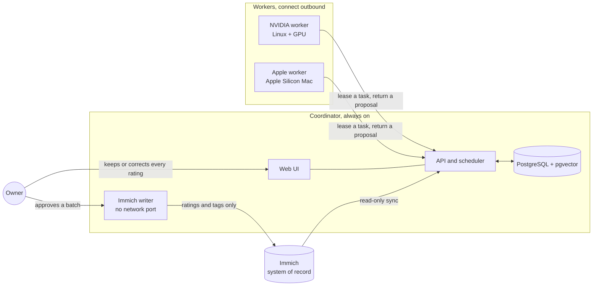

<h1 align="center">Star</h1>

  <strong>Local-first photo curation for <a href="https://immich.app">Immich</a>.</strong> 
  Vision models running on your own machines look at every photo and propose a star rating.
  You keep or correct each one. Nothing is ever deleted, and no photo leaves your home.

  
  
  
  

> **Read this first.** Star runs on any compatible hardware: one coordinator on a Docker host,
> and at least one worker with an NVIDIA GPU or Apple Silicon. It is **not** a one-command
> install. You build the images, download the models and connect the machines yourself, and
> [docs/SETUP.md](docs/SETUP.md) walks through it. It is published as a working reference for a
> local, multi-machine AI pipeline with human approval.

## The problem

A family library grows by tens of thousands of photos, and nobody rates them. The good ones are
buried. Cloud services will sort them for you, in exchange for sending every private photo to
someone else's computer.

Star does the sorting at home. It reads the library from Immich, has local vision-language
models review each photo, and proposes one to five stars. The owner's own rating always wins.
Approved ratings are written back to Immich in a separate, explicitly approved step.

## How it works

1. **Sync.** The coordinator reads the library from Immich with a least-privilege key.
2. **Primary review.** A small vision-language model rates every photo against a scale the
   owner can edit. An image embedding groups near-duplicates into series.
3. **Advanced review.** Photos proposed as four or five stars get a second opinion from a
   larger model. Only that model, or the owner, can publish a final five.
4. **Comparison.** The strongest candidates are compared against each other, so the top tier
   is a fixed share of the collection and not whatever the model felt generous about.
5. **Owner decision.** The owner keeps or corrects ratings in the web UI. Corrections feed a
   private taste calibration.
6. **Write-back.** Approved ratings go to Immich as one immutable batch, after a second,
   explicit approval.

## What it will never do

These are enforced in code and pinned by tests in `backend/tests/safety`.

- **Never delete.** There is no delete, trash or permanent-delete capability anywhere. The
  Immich client has no such method. A low rating is never a deletion.
- **Never decide for you.** Every automated rating is a proposal. The owner's rating overrides
  every model and never moves automatically.
- **Never send photos out.** Inference runs only on your machines. Hosted model APIs, public
  hosts, redirects and proxies are rejected by allow-lists.
- **Never trust the content.** File names, EXIF, captions and model output are untrusted
  evidence, never instructions. Models get no tools, shell, database or Immich access.
- **Never lower what you set.** Write-back compares the remote state first, never lowers an
  existing rating, never clears a description, and adds tags without removing any.

## What you need

| | |
|---|---|
| An Immich server | Star reads from it and writes ratings back. Tested against the 2.7 and 3.0 APIs. |
| A coordinator | Any 64-bit Docker host that stays on: a NAS, a mini PC, a home server or a Linux PC. |
| At least one worker | Linux with an NVIDIA GPU (8 GB of VRAM or more), or a Mac with Apple Silicon (16 GB or more). One machine can be both coordinator and worker. |
| The models | Pulled with Ollama or MLX. They are not part of this repository. |
| Some skill | Docker Compose, a home network you control, and the willingness to read logs. |

Not supported: AMD and Intel GPUs, Intel Macs, and Windows as a worker.

Everything stays on a home network. Star speaks plain HTTP on the LAN and must never be
exposed to the internet.

## Documentation

| | |
|---|---|
| [docs/SETUP.md](docs/SETUP.md) | Compatible hardware and a first install: coordinator, workers, models, Immich key |
| [docs/ADAPTING.md](docs/ADAPTING.md) | What you can configure, and what is still fixed in the code |
| [docs/OPERATIONS.md](docs/OPERATIONS.md) | The maintainer's day-to-day runbook: release, deploy, recover |
| [docs/DECISIONS.md](docs/DECISIONS.md) | Why things are the way they are, one line per decision |
| [AGENTS.md](AGENTS.md) | The project's rules, written for the coding agents that helped build it |

## Built with

Python 3.14, FastAPI, SQLAlchemy and Alembic on PostgreSQL 18 with pgvector. React, TypeScript
and Vite for the web UI. Ollama and MLX for local inference, with DINOv2 image embeddings.
Docker Compose on every machine. About 600 backend tests and 200 frontend tests.

Star was built with AI coding agents under human review. `AGENTS.md` is the rulebook they
worked from, and `docs/DECISIONS.md` is the record of what was decided and why.

## Policies

| | |
|---|---|
| [PRIVACY.md](PRIVACY.md) | What is stored, and why nothing leaves your network |
| [SECURITY.md](SECURITY.md) | How to report a vulnerability, and what is in scope |
| [CONTRIBUTING.md](CONTRIBUTING.md) | How to run the checks, and what the project will accept |
| [CODE_OF_CONDUCT.md](CODE_OF_CONDUCT.md) | Be decent |

## Licence

Free software under the **GNU Affero General Public License v3.0 or later**. See
[LICENSE](LICENSE). The models Star uses are downloaded separately and keep their own licences;
check each one before you use it.

Star is an independent project, not affiliated with or endorsed by Immich.

Copyright © 2026 Alex Roman.
